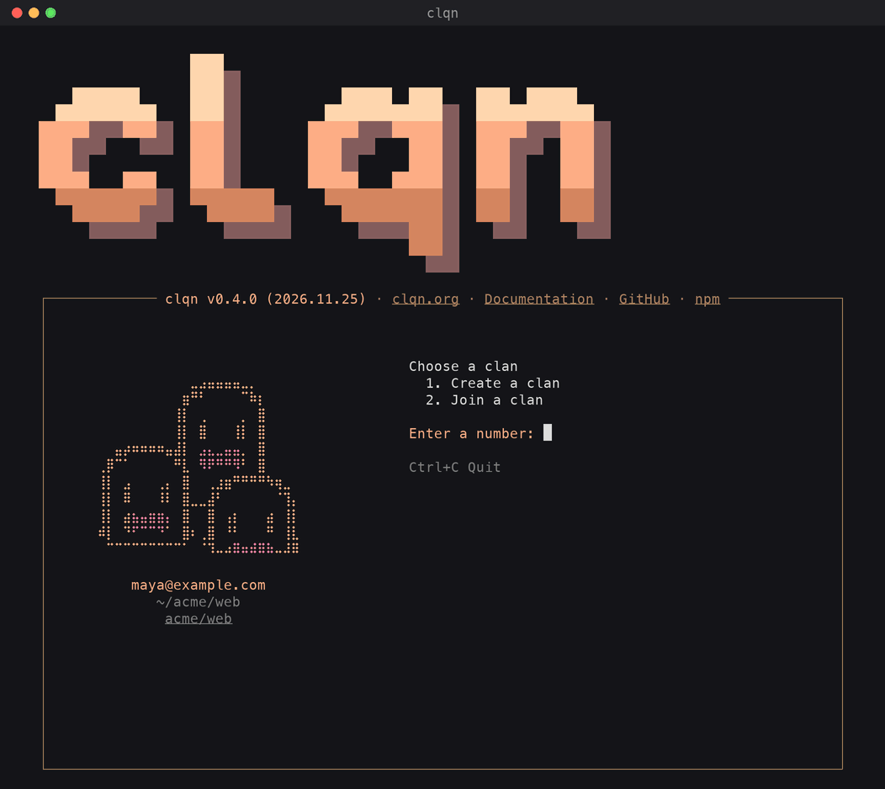

<picture>
  <source media="(prefers-reduced-motion: reduce)" srcset="docs/assets/header.svg">
  
</picture>

<p align="center">
  <a href="https://clqn.org/">clqn.org</a> · <a href="https://clqn.org/download.html">Download</a> · <a href="https://clqn.org/docs/">Documentation</a>
</p>

<p align="center">
<a href="https://github.com/rli8145/clqn/actions/workflows/ci.yml"></a>

<a href="https://npmjs.com/package/clqn-cli"></a>
<a href="LICENSE.md"></a>
</p>

## Why clqn?

Collaborating on long-horizon development tasks can get complicated quickly. Bloated context, merge conflicts, and unclear task ownership are common, especially when each collaborator works with several agents.

Existing solutions introduce a lot of setup overhead. `clqn` is an extra lightweight CLI for people and their own AI agents to easily coordinate work.

`clqn` stands for **clan**. Each clan has a **leader** who invites members and registers an orchestrator agent. **Members** (and the leader) register worker agents.

<picture>
  <source media="(prefers-reduced-motion: reduce)" srcset="docs/assets/demo.png">
  
</picture>

## Installation

Install with npm (Node.js 22.12+):

```sh
npm install -g clqn-cli
```

Alternatively, install with Homebrew:

```sh
brew tap rli8145/clqn https://github.com/rli8145/clqn
brew install clqn
```

## Quick start

Install and sign in to Codex CLI or Claude Code. From your project folder, create a clan, invite your teammate, and open your agent:

```sh
clqn init --invite teammate@example.com --run
```

Your teammate runs this from their project folder to join and open their agent:

```sh
clqn join --run
```

The first command on each machine prompts for GitHub sign-in. Follow the link and enter GitHub's short code. Use the GitHub account with the invited email. With several pending invitations, name the clan, for example `clqn join "My project" --run`.

`clqn init` uses the folder name for the clan. Leave off `--run` to create or join first, then use `clqn agent run` whenever you want a connected session. If both runtimes are installed, use `--run claude` to choose Claude Code. [Agent setup](docs/index.md#connect-an-agent)

`clqn clans` shows your clans, and `clqn use "My project"` switches between them. Hosted clqn keeps your members, tasks, and shared context available to your team. For self-hosted teams, sign in once with `clqn login --server <https-address>`. [Hosting guide](docs/hosting.md)

## Chat with your clan

Run `clqn` to open the shared terminal chat. The clan leader starts the session and joins through the same screen. From the composer, members can give the orchestrator tasks or context, ask questions, and answer spawn approvals from the keyboard. [Chat setup and keybindings](docs/chat.md)

## Share context and coordinate work

```sh
printf 'Run npm test before committing.\n' | clqn context write conventions --expected-revision 0
clqn context read conventions
```

For code tasks, run from your project clone with Git and an authenticated GitHub CLI (`gh`). Use `clqn agent list` to find the worker’s alias. The clan leader can register an optional coordinator with `clqn agent add coordinator --orchestrator`.

```sh
# Orchestrator
clqn task add login-fix --code
clqn task assign login-fix --agent codex-teammate

# Worker
clqn task start login-fix
cd <printed-worktree-path>
# Make changes, test, and commit.
clqn task submit login-fix

# Orchestrator
clqn task check login-fix
clqn task merge login-fix

# Worker
clqn task done login-fix
```

As the leader, run `clqn repo link` once to set up the [GitHub webhook](docs/webhooks.md#link-a-repository). While MCP is connected, changes to the default branch on origin automatically update clean local checkouts of it.

Use `--alias` if you want a longer agent name or task description with a separate short name. See [custom aliases](docs/commands.md#custom-aliases).

### Follow progress

```sh
clqn status
clqn log
```

Use `clqn --help` to explore all commands. Add `--json` for scripting.

## Run your own server

Clone this repository and open a terminal in the clone. Docker Compose starts the clqn server and its database on your machine. The second command creates and signs in to a local account in one step.

```sh
docker compose --profile server up --build -d --wait
docker compose exec -T api node packages/api/dist/manage-user.js create you@example.com \
  | clqn login --server http://127.0.0.1:8080
clqn init "My project"
```

To set up a shared server and enable GitHub sign-in for your team, follow the [hosting guide](docs/hosting.md).

## Documentation

- [Commands](docs/commands.md)
- [Repository workflow](docs/repositories.md) · [GitHub notifications](docs/webhooks.md)
- [Authentication](docs/authentication.md) · [Agent policies](docs/policies.md)
- [Database setup](docs/database.md) · [Hosting](docs/hosting.md)
- [Architecture and roadmap](ROADMAP.md)

## Contributing

[Report an issue](https://github.com/rli8145/clqn/issues) or read the [contribution guide](CONTRIBUTING.md) before submitting a pull request.
