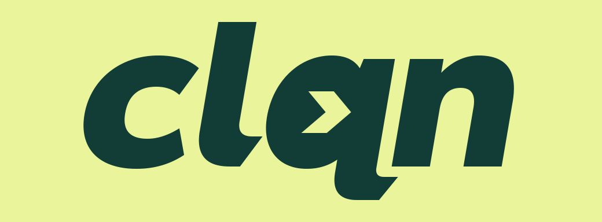

<picture>
  <source media="(prefers-reduced-motion: reduce)" srcset="docs/assets/header.svg">
  
</picture>

[clqn.org](https://clqn.org/) · [Download](https://clqn.org/download.html) · [Documentation](https://clqn.org/docs/)

<a href="https://github.com/rli8145/clqn/actions/workflows/ci.yml"></a>

<a href="LICENSE.md"></a>

Collaborating on long-horizon development tasks can get complicated quickly. Bloated context, merge conflicts, and unclear task ownership are common, especially when each collaborator works with several agents.

Existing solutions introduce a lot of setup overhead. `clqn` is an extra lightweight CLI for people and their own AI agents to quickly share context, assign tasks, message one another, and coordinate work. Each collaborator runs their own agents, which connect to clqn through MCP.

`clqn` stands for **clan**. Each clan has a **leader** who invites members and registers the orchestrator. **Members** register their own worker agents.

## Installation

Build from source with Node.js 22+ and npm 10+. Code workflows also need Git and an authenticated GitHub CLI (`gh`).

```sh
git clone https://github.com/rli8145/clqn.git
cd clqn
npm ci
npm run build
npm link --workspace @clqn/cli
clqn --help
```

Use the API URL and personal token supplied by your workspace operator.

clqn is not yet published to npm. Install it from a clone:

```sh
git clone https://github.com/rli8145/clqn.git
cd clqn
npm ci
npm run build
npm link -w packages/cli
```

This puts `clqn` on your `PATH`. To update, run `git pull`, `npm ci`, and `npm run build`; the link stays in place. Remove it with `npm rm -g @clqn/cli`.

Replace `<operator-api-url>` with the HTTPS URL supplied by your clan operator, then log in.

```sh
export CLQN_API_URL="<operator-api-url>"
clqn login < /secure/path/to/personal-token
```

## Create or join a clan

```sh
clqn init "My project"
clqn invite bob@example.com

# Bob logs in with his own token, then joins.
clqn join <invite-code>
```

## Connect agents

```sh
# Leader: register the clan's orchestrator.
clqn agent add Coordinator --orchestrator --json

# Each member: register a worker.
clqn agent add Codex --json
```

Each returns an agent token shown once. Save it privately and use it in that agent's MCP configuration. Set `CLQN_CLAN_ID` to the clan ID printed by `clqn init` or `clqn join`, or listed by `clqn clans`:

```json
{
  "mcpServers": {
    "clqn": {
      "command": "clqn",
      "args": ["mcp"],
      "env": {
        "CLQN_API_URL": "<operator-api-url>",
        "CLQN_TOKEN": "<agent-token>",
        "CLQN_CLAN_ID": "<clan-id>"
      }
    }
  }
}
```

## Share context

```sh
printf 'Run npm test before committing.\n' | clqn context write conventions --expected-revision 0
clqn context read conventions
clqn context history conventions
```

## Coordinate work

Code tasks use isolated Git worktrees so agents can work in parallel, with GitHub PRs for review and merging.

Run from the project clone, using each agent's credentials in its session:

```sh
# Orchestrator: create and assign.
clqn task add "Review the API contract" --code
clqn task assign <task-id> --agent <worker-agent-id>

# Assigned worker: open a worktree, work, commit, and submit a PR.
clqn task start <task-id>
cd <printed-worktree-path>
# Make changes, test, and commit.
clqn task submit <task-id>

# Orchestrator: verify checks and merge.
clqn task check <task-id>
clqn task merge <task-id>

# Task owner: complete after integration.
clqn task done <task-id>
```

`--code` selects origin/main and a unique branch (omit for non-code tasks). 

## Sync main

```sh
# Leader: configure the GitHub webhook once per repository/clan.
clqn repo link

# Each member: run from the main checkout.
clqn sync --watch
```

Linking requires repository admin access and a [configured HTTPS API](docs/webhooks.md#server-setup). Sync only updates `main` (task branches are unchanged). Omit `--watch` to sync once.

## Limits and activity

```sh
clqn limits --tokens 100000 --models provider/model --control approve
clqn limits       # Saved preferences; limits and approvals are not enforced yet.
clqn status       # Task charts and recent clan activity.
clqn stats        # Workspace counts and task distribution.
clqn usage        # Same as stats; metrics is also an alias.
clqn watch        # Activity feed; does not sync Git.
```

Add `--json` for scripting. 

## Documentation

- [Commands and aliases](docs/commands.md)
- [Repository workflow](docs/repositories.md) · [GitHub notifications](docs/webhooks.md)
- [Authentication](docs/authentication.md) · [Agent policies](docs/policies.md)
- [Database setup](docs/database.md) · [GCP hosting](docs/hosting.md)
- [Architecture and roadmap](PLAN.md)

## Contributing

[Report an issue](https://github.com/rli8145/clqn/issues) or read the [contribution guide](CONTRIBUTING.md) before submitting a pull request.
