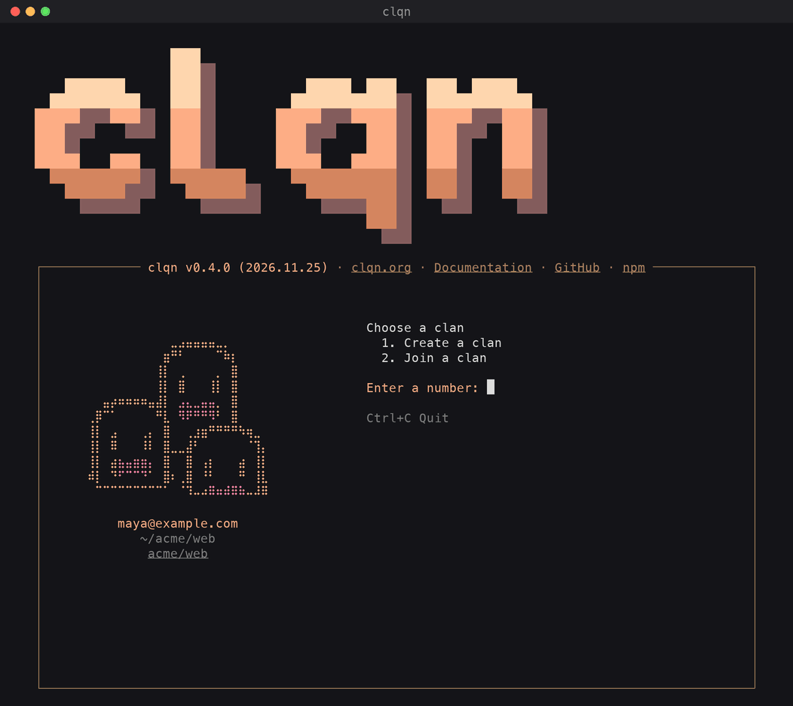

# Getting started

clqn is one terminal chat for your team and its AI agents. You ask the orchestrator for work, it splits the work into tasks, and your teammates' agents do them once each owner approves.



## Before you begin

[Install clqn](../README.md#install), then make sure you have:

- Git, and the GitHub CLI (`gh`) signed in with push access to the repository
- Claude Code or Codex CLI, installed and signed in

## Sign in

Run `clqn` in your project's GitHub clone. Open the GitHub link it shows and enter the one-time code. clqn uses the hosted server unless you choose another one with `clqn --api-url https://clqn.example.com`.

## Create or join a clan

A clan is your team's shared chat. Choose **Create a clan** and name it (the folder name is the default). Say yes when clqn offers to link the repository. Linking needs admin access to the GitHub repository. Then invite teammates from another terminal:

```sh
clqn invite teammate@example.com
```

Your teammate runs `clqn` in their clone, signs in with the GitHub account for that email, and chooses **Join a clan**. Invitations expire after seven days.

When you create or join a clan, choose **Full access** or **Custom** [limits](policies.md) for agents on your machine.

## Use the chat

Type a request, question, or piece of context and press **Enter**. The orchestrator answers below your message and, when it needs an agent on your machine, asks for your approval. See [chat and keys](chat.md).

Press **Ctrl+S** to open settings, where you choose which installed agents (Claude Code, Codex) to offer and change your limits.

Every time you run `clqn` it asks which clan to open, and you can also create or join one there. Press Enter to reopen the clan you used last.
